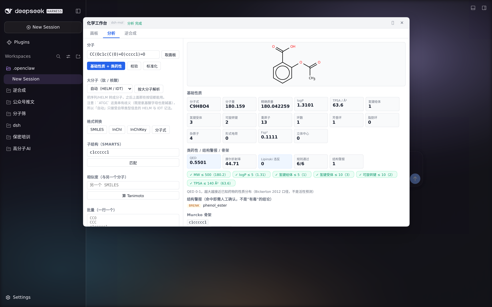
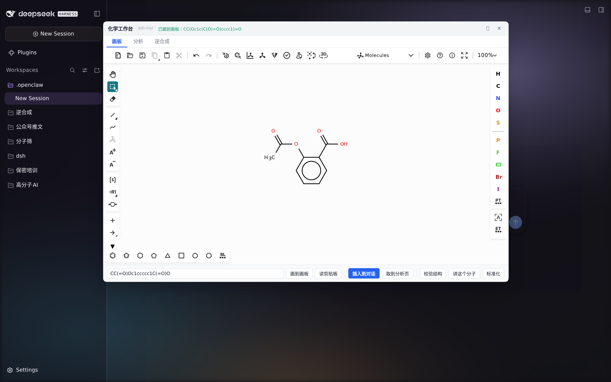
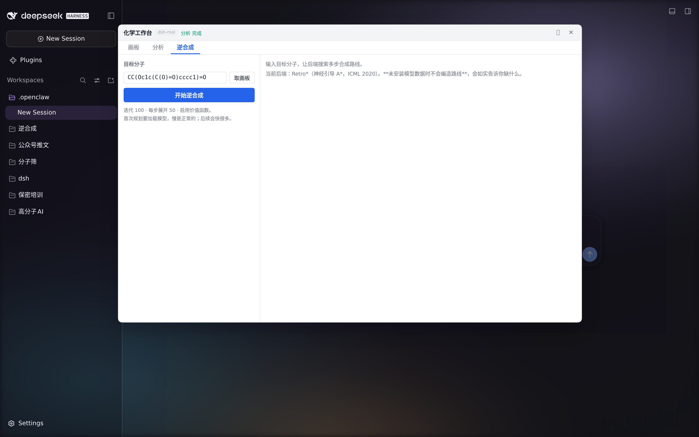

<div align="center">

# dsh-mol · une station de travail de chimie

**Un canevas pour dessiner des molécules et une station de travail RDKit locale, juste à côté de la zone de conversation de votre agent IA.**

Dessinez une structure → un clic → formule brute / masse molaire / logP / TPSA / caractère médicamenteux / alertes structurales **calculés sur-le-champ** →
déposez la structure dans la conversation et laissez l'agent enchaîner.

RDKit pur. **Aucun réseau, aucune clé d'API, aucun service externe.** Utilisable aussi comme serveur MCP stdio, appelable directement par Claude Code / Codex.

[](https://github.com/Yijian-quiet/dsh-mol/actions/workflows/ci.yml)
[](https://awesome-dsh-plugin.com)
[](https://m8ven.ai/mcp/yijian-quiet/dsh-mol?s=readme)


[中文](README.md) | [English](README.en.md) | [日本語](README.ja.md) | [한국어](README.ko.md) | **Français** | [繁體中文](README.zh-TW.md)



</div>

---

## Comprendre en 30 secondes

| | |
|---|---|
| 🎨 **Dessiner des molécules** | Un bouton à côté de la zone de conversation → une superposition du canevas Ketcher. **La conversation n'est pas poussée de côté**, et un clic insère la structure dans le champ de saisie |
| ⚡ **Analyse instantanée** | Formule brute, masse molaire, masse exacte, logP, TPSA, HBD/HBA, cycles, Fsp³, stéréocentres — calculés **immédiatement** par RDKit en local, sans appel à un modèle ni attente d'un LLM |
| 💊 **Est-ce que ça ressemble à un médicament ?** | Verdicts Lipinski / Veber règle par règle, QED, alertes structurales PAINS / BRENK, squelette de Murcko |
| 🧹 **Secours pour données sales** | Validation (erreurs en langage clair + position des caractères), standardisation (chaque modification est enregistrée), déduplication, nettoyage par lots |
| 🧭 **Rétrosynthèse** | L'onglet est en place et le backend est interchangeable (Retro* aujourd'hui). **Si les données du modèle ne sont pas installées, il le dit franchement — il n'invente jamais de voie de synthèse** |
| 🔌 **Deux façons de s'en servir** | La station de travail graphique est faite pour les humains ; le même cœur passe aussi par MCP pour les agents — **une seule implémentation, deux points d'entrée** |

> Un peu de contexte : npm compte **618** plugins DSH, dont **0** en chimie / matériaux / molécules.
> Ce dépôt existe pour combler ce vide.

---

## Démarrage rapide

```bash
# 1) Installez le cœur + l'adaptateur MCP (publié sur PyPI)
pip install 'dsh-mol[mcp]'
#    En cas d'échec, passez par git : pip install "dsh-mol[mcp] @ git+https://github.com/Yijian-quiet/dsh-mol.git"

# 2) Installez le plugin dans votre profil DSH (aucun compte npm requis, pnpm gère les sous-répertoires git)
dsh plugin --profile web add 'github:Yijian-quiet/dsh-mol#path:dsh-bundle'
dsh plugin --profile web add 'github:Yijian-quiet/dsh-mol#path:dsh-ui'   # ← la station de travail graphique

# 3) Ouvrez DSH Web et cliquez sur « station de travail », à gauche du champ de saisie
```


> ✅ **Publié sur PyPI** : `pip install 'dsh-mol[mcp]'` (en ligne depuis le 2026-09-26 ; après installation, `dsh-mol-mcp --selftest` fait un autodiagnostic).
> ⏳ **Pas encore sur npm**, donc le plugin lui-même s'installe toujours avec `dsh plugin add github:…` — rien n'est bloqué pour autant.
>
> ✅ Référencé dans le [marché de plugins dsh](https://awesome-dsh-plugin.com) (deux entrées,
> `dsh-mol#dsh-ui` et `dsh-mol#dsh-bundle`, catégorie `tools`) — vous pouvez aussi l'installer depuis le marché.

La station de travail a besoin d'un `python3` local capable de faire `import rdkit` ; le canevas est une compilation statique de [Ketcher](https://github.com/epam/ketcher) qui **s'affiche localement dans le navigateur, sans passer par le moindre backend**.

<details>
<summary>Vous préférez la ligne de commande, ou un autre client MCP ?</summary>

```bash
dsh-mol-mcp --selftest          # autodiagnostic d'abord (aucun client MCP requis)
```

```yaml
# superposition manuelle du patch, transport stdio, entièrement local
- insert:
    - id: dsh-mol
      name: '@deepseek-ai/dsh-mcp-client'
      config:
        serverName: chem
        transport: stdio
        command: python3
        args: ['-m', 'dsh_mol_mcp.server']
        env:
          PYTHONPATH: /path/to/dsh-mol/src
          MOL_OUT: /path/to/out
```

Les outils apparaissent côté modèle sous des noms comme `mcp__chem__chem_check_smiles`.
</details>

---

## À quoi ressemble la station de travail

Trois onglets, une molécule :

<table>
<tr>
<td width="33%"><br><b>① Canevas</b><br>Le canevas Ketcher complet (la superposition se déplace et se maximise). « Insérer dans la conversation » écrit le SMILES dans le champ de saisie — <b>le texte, c'est la structure seule, sans aucun chemin interne glissé dedans</b>.</td>
<td width="33%"><br><b>② Analyse</b><br>Saisie et boutons à gauche, chiffres à droite. Propriétés de base + caractère médicamenteux + alertes structurales + squelette en une seule passe, le tout calculé en direct par RDKit en local.</td>
<td width="33%"><br><b>③ Rétrosynthèse</b><br>Molécule cible → voie multi-étapes. Sans données de modèle installées, <b>il vous dit quoi télécharger et où le placer</b> au lieu de prétendre avoir calculé quelque chose.</td>
</tr>
</table>

### Pourquoi le dessin n'est-il pas rendu dans le panneau ?

Parce que **une image doit suivre le texte qui l'explique**. La vignette dans la station de travail sert seulement à confirmer *quelle* molécule a été calculée ;
la vraie image de la structure est dessinée en ligne par l'agent dans sa réponse (`read_image`), juste à côté de son explication de cette molécule.

Ce choix s'est imposé après deux versions rejetées par les utilisateurs :
d'abord « le panneau mange la zone principale et étouffe la conversation », puis « une seconde vignette dans le canevas ne sert à rien ».
Aujourd'hui, **la conversation garde sa mise en page et la station de travail se tient à côté**.

---

## Pourquoi se contenter d'envelopper RDKit ne suffit pas

Parce qu'une enveloppe naïve tend trois pièges à un agent IA, et ces trois pièges mordent pour de vrai en recherche :

### 1. Quand RDKit échoue à analyser, il **ne lève pas d'exception** : il renvoie `None`

La raison de l'échec part dans un journal stderr côté C++. Avec une enveloppe naïve, le modèle ne reçoit qu'un `None` vide et n'a aucune idée de ce qui a échoué.
Cet outillage redirige et capture le journal de RDKit, **le traduit en langage clair**, et fournit une **position de caractère** quand elle peut être localisée :

```jsonc
// chem_check_smiles("C1CC")
{ "level": "error",
  "diagnostics": [{ "code": "unclosed_ring",
                    "message": "环闭合标记没有配对：SMILES 里的成环数字（如 C1...C1）出现次数必须是偶数" }] }

// chem_check_smiles("CC(=O)O)")   ← une parenthèse fermante en trop, repérée au caractère 7
{ "level": "error", "position": 7,
  "diagnostics": [{ "code": "extra_paren", "message": "多余的右括号：) 比 ( 多" }] }
```

### 2. `MolFromSmiles("")` ne renvoie pas `None`, mais **une molécule vide à 0 atome**

Une implémentation naïve déclarerait une entrée vide **valide**. Or `"   "` (uniquement des espaces) **renvoie bien** `None` —
une seule fonction, deux entrées vides, deux comportements. Cet outillage intercepte les deux au niveau du domaine.

### 3. Les résultats sont **à trois niveaux**, pas succès/échec

`[Fe+9]` s'analyse, mais la charge est absurde. Cela mérite un *avertissement*, pas un rejet :

| level | signification |
|---|---|
| `ok` | passe sans problème |
| `warn` | s'analyse, mais la structure est suspecte (charge anormale, aromaticité douteuse…), avec les raisons |
| `error` | échec d'analyse, avec une raison en langage clair et une position de caractère localisable |

**Et les API par lots ne perdent jamais de données en silence.** Chaque ligne a un statut explicite (ok / warn / failed),
et les échecs sont listés un par un — en recherche, « deux lignes ont disparu sans rien dire » est bien plus dangereux qu'une erreur.

### Les diagnostics sont bilingues

Chinois par défaut ; une seule variable d'environnement suffit pour un environnement anglophone :

```bash
export MOL_LANG=en        # zh (défaut) / en
```

> ⚠️ **Le contrat, c'est le `code`, pas le texte du message.** Le `code` (`unclosed_ring` / `valence` …) ne dépend pas de la langue,
> et il **ne change ni `level`, ni `position`, ni `canonical` quand la langue change** — des cas de régression dédiés verrouillent ce point.

---

## Les outils (13, tous 100 % locaux)

| Outil | Rôle |
|---|---|
| `chem_check_smiles` | valider + normaliser : résultat à trois niveaux, raisons en langage clair, position des caractères |
| `chem_properties` | formule brute / masse molaire / masse exacte / logP / TPSA / HBD / HBA / cycles / stéréocentres |
| `chem_analyze` | tout d'un coup : propriétés de base + caractère médicamenteux + alertes structurales + squelette de Murcko |
| `chem_druglikeness` | verdicts Lipinski / Veber règle par règle, QED, alertes structurales PAINS / BRENK |
| `chem_draw_molecule` | dessiner une structure (PNG/SVG, indices d'atomes et mise en évidence de sous-structure en option) → renvoie un **chemin de fichier** |
| `chem_draw_grid` | grille multi-molécules (pour rapports et articles) ; les entrées invalides sont écartées mais consignées une par une |
| `chem_convert` | conversion smiles / inchi / inchikey / mol / sdf / formula |
| `chem_bioseq` | séquence de peptide / d'acide nucléique, HELM ou notation IDT → une molécule (et un SMILES canonique que les autres outils peuvent consommer) ; **kind doit être explicite** |
| `chem_standardize` | retirer les sels / déconnecter les métaux / neutraliser / normaliser — **chaque modification est enregistrée** |
| `chem_dedupe` | déduplication par structure canonique, avec les groupes de doublons |
| `chem_substructure_match` | recherche de sous-structure SMARTS, renvoie les indices d'atomes |
| `chem_similarity` | similarité d'empreintes (morgan / rdkit / maccs) |
| `chem_batch_clean` | nettoyer une colonne de SMILES : résumé des comptes + liste des échecs (+ rapport CSV en option) |

L'onglet « Analyse » de la station de travail et ces outils **partagent le même `chemcore`** — pas de dérive entre « l'interface calcule une chose et l'agent une autre ».

> `chem_core` dispose aussi d'un point d'entrée JSON `python3 -m chemcore.cli` (une ligne JSON en entrée, une ligne JSON en sortie) ;
> les chiffres en direct de la station de travail passent par lui. C'est la couture par laquelle « les outils pour l'IA » et « une interface pour les humains » partagent une seule implémentation.

## Biomolécules (peptides / acides nucléiques)

Les peptides et acides nucléiques dessinés dans l'éditeur de macromolécules de Ketcher **n'ont pas de SMILES** — seulement une
séquence ou du HELM. `chem_bioseq` les transforme en molécule et renvoie un **SMILES canonique**,
si bien que tous les outils ci-dessus (properties / analyze / draw / convert) continuent de travailler sur la même molécule.

```python
cc.parse_bioseq("GAVL", kind="peptide")            # peptide, 1 lettre → C16H30N4O5 / 358.4
cc.parse_bioseq("Gly-Ala-Val", kind="peptide3")    # peptide, 3 lettres → tripeptide C10H19N3O4 / 245.3
cc.parse_bioseq("AUGC", kind="rna")                # RNA → C38H48N15O26P3 / 1223.8
cc.parse_bioseq("ATGC", kind="dna")                # DNA → C39H50N15O22P3 / 1173.8
cc.parse_bioseq("PEPTIDE1{G.A.V.L}$$$$")           # HELM : le préfixe déclare le type, auto suffit
```

### Pourquoi `kind` doit être explicite

Parce que `A/T/G/C` sont **à la fois des acides aminés et des bases**
(Ala/Thr/Gly/Cys ↔ adénine/thymine/guanine/cytosine). Le même `ATGC` vaut `C12H22N4O6S` en peptide,
`C39H50N15O26P3` en RNA et `C39H50N15O22P3` en DNA — trois molécules différentes —
alors que le `MolFromSequence` de RDKit **le lit par défaut comme un peptide, sans la moindre erreur**.

La règle est donc la suivante :

- **Une séquence nue doit porter un `kind` explicite** (même avec `auto`) ; sinon c'est une erreur —
  « impossible de déterminer si … est un peptide ou un acide nucléique, analyse refusée ».
  **Nous ne choisissons jamais de valeur par défaut à votre place** : un mauvais choix donne un résultat
  « chimiquement complètement faux, et sans la moindre trace », ce qui est plus dangereux qu'une erreur.
- **Seules** deux notations qui portent elles-mêmes leur information de type peuvent être déduites
  sous `auto` : **HELM** (son préfixe `PEPTIDE1{` / `RNA1{` / `DNA1{` est une **déclaration**, pas
  une supposition) et **IDT** (le préfixe de sucre `r`/`d` est lui aussi une déclaration). Tout le
  reste est refusé sous `auto` : une séquence nue (`ACGU` / `ATGC` / `GAVL`) ne porte aucune
  information de type et ne reçoit aucune valeur par défaut.

> Deux pièges RDKit que nous avons mesurés et contournés : **le flavor du DNA est 6, pas 3**
> (3 signifie « RNA avec une coiffe phosphate en 5' » et ajoute un phosphate superflu) ; et **les codes
> d'acides aminés à 3 lettres ne sont pas du tout pris en charge par RDKit 2023.09.6** — il lit
> `Gly-Ala-Val` comme des lettres uniques insensibles à la casse et obtient un 9-mère (masse 890.1)
> sans aucune erreur, donc `peptide3` est traduit ici même en codes à 1 lettre. Les espaces dans une
> séquence sont eux aussi silencieusement transformés en hydrogènes supplémentaires par RDKit ; nous les
> normalisons d'abord et consignons la modification dans `warnings`.

### La notation IDT (ce que Ketcher exporte)

Quand l'éditeur de macromolécules de Ketcher exporte un acide nucléique, il produit la **notation
IDT** (mesuré : dessiner un RNA donne `rArCrGrTrU/3Phos/`) : les résidus portent un préfixe de sucre
(`r`=ribose, `d`=désoxy, `m`=2'-O-méthyl, `+`=LNA) et il y a des modifications terminales comme
`/3Phos/` ou `/5Phos/`. `chem_bioseq` l'accepte telle quelle — d'où la nouvelle valeur `idt` pour
`kind` (`auto` la reconnaît aussi : le préfixe de sucre est une **déclaration**, pas une supposition).

**Mais la conversion n'a lieu que si elle est sans perte.** Type de sucre uniforme et aucune
modification : la notation devient une séquence simple confiée à RDKit. Dès qu'un élément ne peut pas
être exprimé, l'outil refuse et dit pourquoi :

```python
cc.parse_bioseq("rArCrGrTrU", kind="idt")         # → RNA ACGTU / masse 1543.997 (sucre uniforme, sans modif : sans perte)
cc.parse_bioseq("rArCrGrTrU/3Phos/", kind="idt")  # ✗ refusé : forcer la conversion perdrait un phosphate 3′ en silence (≈79.97 Da)
```

Chaque refus nomme le coupable :

- modifications terminales / de squelette : `/3Phos/`, `/5Phos/`, `*` (phosphorothioate)
- sucres non standard : `m` (2'-O-méthyl), `+` (LNA)
- sucres mélangés : `rArCdT` (ribose et désoxy dans la même chaîne — RDKit n'en exprime qu'un à la fois)
- un conflit avec le `kind` fourni par l'appelant : `rArCrG` + `kind="dna"` (le préfixe déclare du RNA)

La raison est la même que plus haut : forcer la conversion n'est pas une approximation, c'est un
résultat **chimiquement complètement faux que rien ne trahit** — 79.97 Da de moins, et l'interface
paraît parfaitement normale.

## API Python

```python
import chemcore as cc

cc.check("C1CC").diagnostics[0].message   # '环闭合标记没有配对：…'
cc.properties("CC(=O)Oc1ccccc1C(=O)O")    # {'formula': 'C9H8O4', 'mw': 180.159, …}
cc.analyze("CC(=O)Oc1ccccc1C(=O)O")       # + QED / Lipinski / alertes PAINS / squelette de Murcko
cc.draw("CCO", atom_indices=True)         # {'path': '…/CCO.png', …}
cc.standardize("CC(=O)[O-].[Na+]")        # {'output': 'CC(=O)O', 'changes': [...]}
cc.batch_clean(["CCO", "C1CC"])           # {'ok': 1, 'failed': 1, 'failed_items': [...]}
cc.parse_bioseq("GAVL", kind="peptide")   # peptide/ARN/ADN/HELM → molécule + SMILES canonique (kind requis)
```

## Exemple concret : nettoyer une table de monomères sale

[`examples/monomer_cleanup.py`](examples/monomer_cleanup.py) prend une table de monomères volontairement en désordre
(la même molécule écrite de deux façons, un sel de sodium, une faute de fermeture de cycle, une valence impossible, une charge absurde) et déroule toute la chaîne :

```bash
python3 examples/monomer_cleanup.py
```

Il rapporte 11 réussites, 1 avertissement et 2 échecs, fusionne les doublons, déroule chaque étape de déselage et de neutralisation,
puis dessine les 12 structures représentables et liste les 2 écartées avec leurs raisons.


## Rétrosynthèse

Le backend de l'onglet rétrosynthèse est **interchangeable** : le plugin utilise `child_process` pour lancer un processus qui reçoit du JSON sur stdin
et écrit du JSON sur stdout, en pointant par défaut vers le script de pont Retro* de ce dépôt.

- Quand le backend n'est **pas installé** : il renvoie un diagnostic structuré (quels fichiers manquent, où les télécharger, où les placer) et l'interface l'affiche tel quel —
  **il n'invente pas de voie de synthèse**, et il ne masque pas le manque avec quelque chose qui y « ressemble »
- Pour changer de backend (AiZynthFinder / votre propre RetroChimera / le serveur interne de votre équipe) : respectez le même
  protocole stdin/stdout et pointez `retroCommand` dessus

L'installation de Retro* (sources + données de modèle, de l'ordre du Go) est décrite dans **[docs/RETROSYNTHESIS.md](docs/RETROSYNTHESIS.md)**.

## Tests

```bash
PYTHONPATH=src python3 tests/run_tests.py    # 71 cas principaux (zéro dépendance, pytest inutile)
PYTHONPATH=src python3 tests/mcp_smoke.py    # test de fumée au niveau protocole MCP (vrai serveur, vrais appels d'outils)
bash tests/run_all.sh                        # les deux ci-dessus plus les autotests, en une seule fois
```

L'interface est recettée en mode headless avec Playwright (33 assertions, couvrant « peut-on encore utiliser la conversation après avoir ouvert la station de travail »,
« ces chiffres sont-ils réellement calculés » et « invente-t-il une voie quand le backend n'est pas installé ») :

```bash
dsh web --port 3081 --no-open > /tmp/chemver.log 2>&1 &
CHEM_BASE=http://127.0.0.1:3081 \
CHEM_TOKEN=$(grep -o 'token=[^ ]*' /tmp/chemver.log | cut -d= -f2) \
node dsh-ui/tests/verify-ui.cjs
```

> N'expérimentez pas sur le port que vous utilisez — lancez une instance séparée et arrêtez-la une fois terminé.

## Principes de conception

1. **Zéro réseau** : tous les calculs se font dans ce processus.
2. **Zéro dépendance supplémentaire** : le cœur n'a besoin que de RDKit ; les tests n'ont même pas besoin de pytest.
3. **Les échecs parlent humain** : les journaux C++ anglais de RDKit deviennent des diagnostics gradués.
4. **Aucune perte de données silencieuse** : les API par lots rendent compte de chaque ligne.
5. **Toujours préciser le sens d'un chiffre** : logP est signalé comme une estimation de Crippen ; `mw` et `exact_mw` sont expliqués chacun.
6. **Écrire des fichiers, renvoyer des chemins** : les images ne sont pas enfouies dans les charges utiles du protocole mais écrites sur disque et renvoyées sous forme de chemin — reproductible, versionnable, prêt pour un article.
7. **Dire ce qui manque** : pas de valeurs expérimentales, pas de prédiction d'activité ; si le backend de rétrosynthèse n'est pas installé, le dire.

## Feuille de route

- **v0.1 (actuelle)** : 13 outils purement locaux + la station de travail de chimie (canevas / analyse / cadre de rétrosynthèse)
- **v0.2** : backend de rétrosynthèse réellement fonctionnel (données Retro* en place) + affichage des voies dans la station de travail
- **v0.3** : davantage de fiches d'analyse (pKa / conformères / propriétés PK), visualisation passant à « structure + graphiques »
- **Non décidé** : image → structure (OCSR) exige un modèle de plusieurs centaines de Mo, ce n'est donc **pas un « outil de base léger »** ; ce sera un backend interchangeable

## Limites

- Il n'y a **aucune valeur expérimentale** ici. `logP`, `TPSA` et `QED` sont calculés ou estimés et ne remplacent pas une mesure.
- Une alerte structurale **ne signifie pas** « toxique » : elle dit seulement que « ce genre de sous-structure mérite un coup d'œil humain ».
- Il n'y a **pas** de reconnaissance d'image, ni de nom → structure (OPSIN et compagnie).
- La recherche SMARTS est une correspondance structurale, **pas** un jugement de réactivité.
- **Les biomolécules se limitent aux monomères standard** : `peptide3` connaît les 20 codes à trois lettres
  des acides aminés standard ; les résidus modifiés, les monomères non naturels et les glycanes n'ont pas de
  prise en charge fiable au niveau RDKit. Mesure faite : l'analyse HELM de RDKit 2023.09.6 **ne prend pas en
  charge `DNA1` ni `CHEM1`** (elle renvoie None) ; dans ce cas nous levons une erreur claire au lieu de
  renvoyer un résultat vide.
- **C'est vous qui indiquez le type de séquence** : `A/T/G/C` sont valides à la fois dans les peptides et les acides
  nucléiques, donc une séquence nue ambiguë est **refusée** plutôt que dotée d'une valeur par défaut (voir la section « Biomolécules »).
- **InChI ne prend pas en charge l'atome factice `*`** : les RU-SMILES de polymères (par ex. `*OCCOC(=O)c1ccc(C(=O)O*)cc1`) **ne peuvent pas** être convertis en InChI / InChIKey.
  Nous **ne renvoyons pas silencieusement une chaîne vide** (ce que fait RDKit) ; nous levons une erreur claire et suggérons le SMILES canonique comme identifiant unique —
  parce que l'entrée la plus courante dans ce domaine est justement celle qui porte un `*`.
- Ceci est `v0.0.3` : l'API peut changer ; les issues sont bienvenues.

## Arborescence du dépôt

```
src/chemcore/          cœur RDKit pur (source unique de vérité) + entrée CLI JSON
src/dsh_mol_mcp/       adaptateur MCP stdio (13 outils)
dsh-ui/                station de travail de chimie (plugin client DSH : moitié hôte + moitié navigateur)
dsh-ui/retro/          pont vers le backend de rétrosynthèse (interchangeable, Retro* par défaut)
dsh-bundle/            bundle DSH (configuration seule, pointant vers le serveur MCP ci-dessus)
dsh/                   patch pour superposition manuelle (chemins locaux en dur)
tests/                 tests sans dépendance + fumée protocole MCP + recette d'interface Playwright
docs/                  images de démonstration et documents d'approfondissement
```

## Une exigence à connaître (un piège bien réel)

**Le SDK Python MCP doit être en 1.x** :

```bash
pip install 'mcp>=1.0,<2'
```

Le SDK **2.x a renommé `FastMCP` en `MCPServer`** avec des changements d'API cassants.
Notre extra `[mcp]` épingle déjà `<2` ; si vous avez installé 2.x à la main, `dsh-mol-mcp` **vous dit exactement quoi faire**
(au lieu de déverser une trace) — la CI a trouvé ce piège dans un environnement propre, ce n'est pas une supposition.

## Remerciements

- [RDKit](https://www.rdkit.org/) — tout le cœur chimique
- [Ketcher](https://github.com/epam/ketcher) — le canevas (rendu wasm local, sans réseau)
- [Retro*](https://github.com/binghong-ml/retro_star) (ICML 2020) — l'un des backends de rétrosynthèse

## Licence

MIT

<!-- dsh-mol:test-count 71 -->
<!-- dsh-mol:tool-count 13 -->
<!-- dsh-mol:ui-assertions 33 -->
